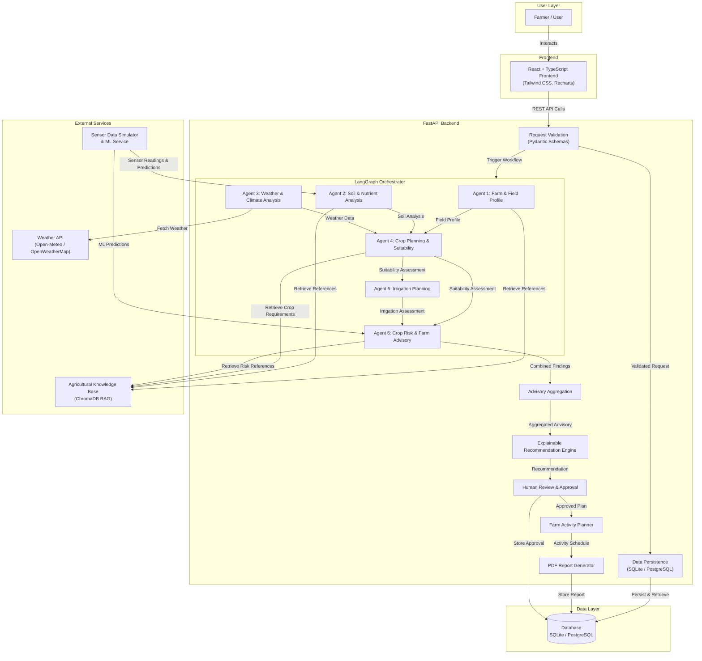
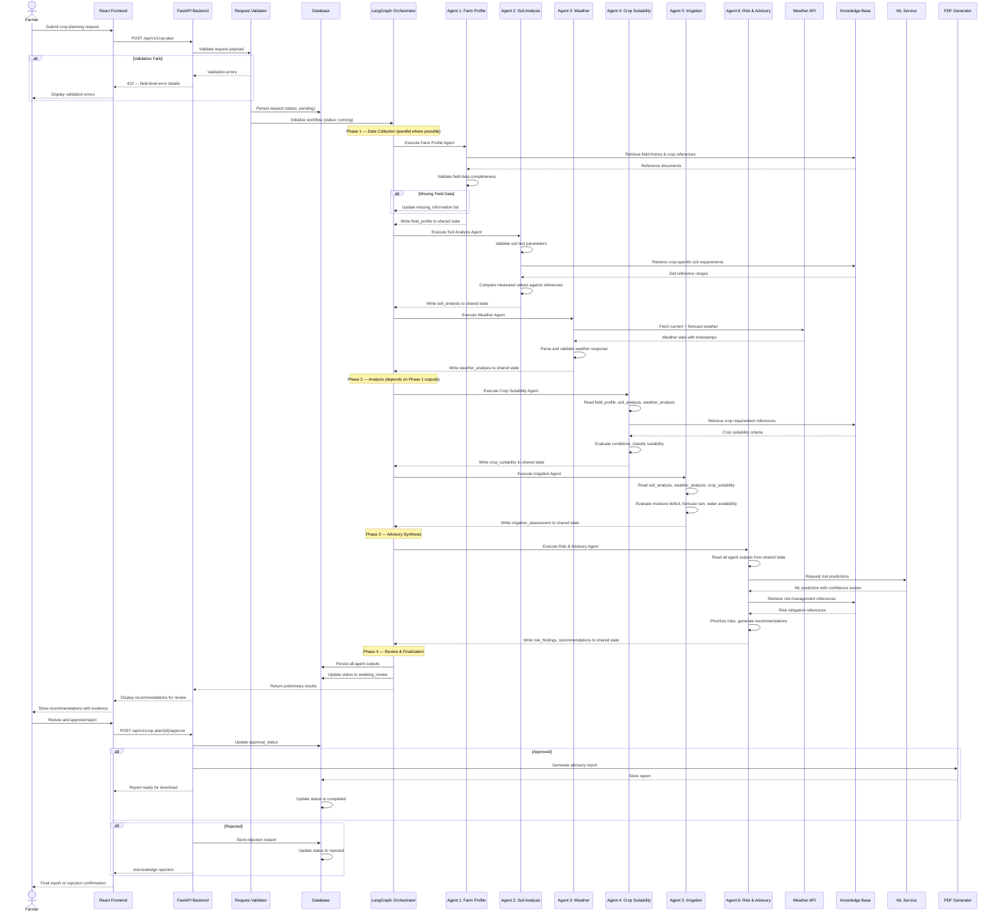
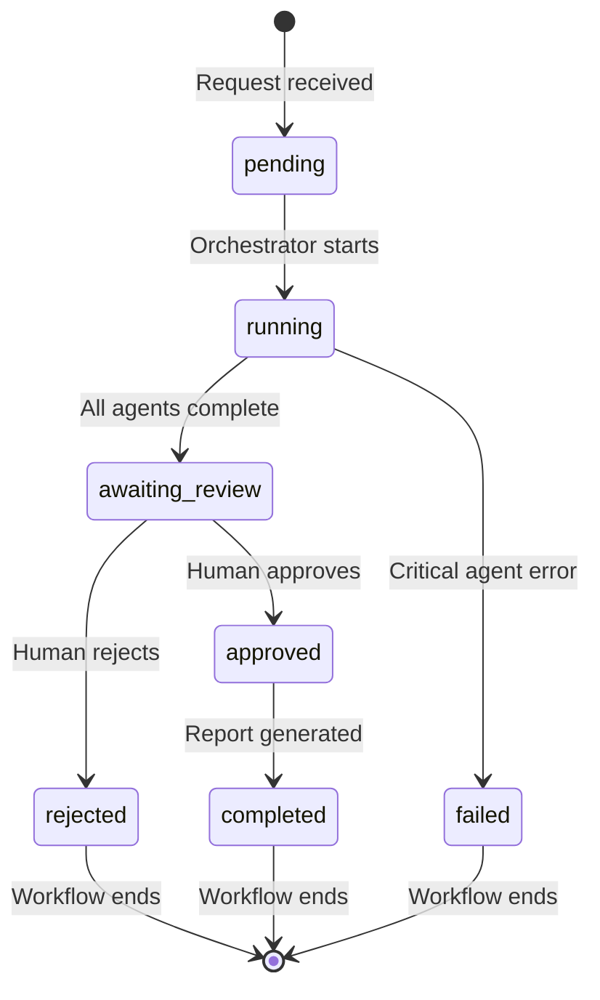

# AgriSārathi — System Architecture

> **Document Status:** Phase 1 — Design Specification (not yet implemented)

---

## Table of Contents

1. [Architecture Overview](#architecture-overview)
2. [System Architecture Diagram](#system-architecture-diagram)
3. [Request Lifecycle Sequence Diagram](#request-lifecycle-sequence-diagram)
4. [Shared Workflow State Design](#shared-workflow-state-design)
5. [Agent State Read/Write Matrix](#agent-state-readwrite-matrix)
6. [Workflow Status Definitions](#workflow-status-definitions)
7. [Design Decisions](#design-decisions)

---

## Architecture Overview

AgriSārathi follows a **multi-agent orchestration** pattern where a central LangGraph workflow graph coordinates six specialized agents. Each agent operates on a **shared state object** that flows through the graph, with each agent reading its required inputs and writing its outputs to designated state fields.

### Key Architectural Principles

- **Single Source of Truth** — The shared workflow state is the canonical record of all agent inputs, outputs, and status transitions.
- **Data Provenance** — Every data point carries its source, timestamp, and measurement method.
- **Fail-Safe Defaults** — Missing data triggers explicit "Additional Information Required" status rather than silent substitution.
- **Human-in-the-Loop** — Recommendations enter an `awaiting_review` state and require explicit farmer/agronomist approval before finalization.
- **Separation of Concerns** — Each agent has a bounded responsibility; cross-cutting analysis happens only in the final advisory agent.

---

## System Architecture Diagram



### Component Descriptions

| Component | Responsibility |
|-----------|---------------|
| **React Frontend** | User interface for field data entry, dashboard visualization, recommendation review, and PDF download |
| **FastAPI Backend** | REST API layer handling request validation, authentication (planned), routing, and response formatting |
| **Pydantic Schemas** | Input/output validation ensuring data type correctness and required field presence |
| **LangGraph Orchestrator** | Manages the directed graph of agent execution, state transitions, and conditional routing |
| **Six Specialized Agents** | Individual reasoning units, each with bounded scope (see [agents.md](agents.md)) |
| **Advisory Aggregation** | Combines findings from all agents into a unified risk-prioritized view |
| **Explainable Recommendation Engine** | Generates human-readable recommendations with evidence citations and uncertainty disclosure |
| **Human Review & Approval** | Holds recommendations in `awaiting_review` until a farmer or agronomist explicitly approves or rejects |
| **Farm Activity Planner** | Converts approved recommendations into a calendar of farming activities |
| **PDF Report Generator** | Compiles analysis results, recommendations, and evidence into a downloadable report |
| **Weather API** | External service providing current conditions and multi-day forecasts |
| **ChromaDB Knowledge Base** | Vector database storing embedded agricultural reference material for RAG retrieval |
| **Sensor Data Simulator & ML Service** | Generates simulated sensor readings (dev) and serves ML model predictions |
| **Database** | Persists field profiles, soil tests, agent outputs, recommendations, and approval history |

---

## Request Lifecycle Sequence Diagram



---

## Shared Workflow State Design

The shared workflow state is a structured object that flows through the LangGraph orchestration graph. Each agent reads its required inputs from the state and writes its outputs to designated fields. The state is persisted to the database at key checkpoints.

### Proposed State Schema

```python
# Planned schema — not yet implemented as code

SharedWorkflowState = {
    # === Identifiers ===
    "request_id": str,          # Unique identifier for this crop-planning request
    "field_id": str,            # Identifier for the target field

    # === Agent Outputs ===
    "field_profile": {          # Written by Agent 1
        "farm_id": str,
        "field_area_hectares": float,
        "latitude": float | None,
        "longitude": float | None,
        "soil_type": str,
        "previous_crop": str | None,
        "proposed_crop": str,
        "irrigation_source": str,
        "water_availability": str,
        "completeness_score": float,
        "collected_at": str,        # ISO 8601 timestamp
    },

    "soil_analysis": {          # Written by Agent 2
        "measured_values": {
            "soil_ph": float | None,
            "nitrogen_kg_per_ha": float | None,
            "phosphorus_kg_per_ha": float | None,
            "potassium_kg_per_ha": float | None,
            "soil_moisture_percent": float | None,
            "organic_matter_percent": float | None,
        },
        "measurement_timestamp": str | None,
        "measurement_source": str,
        "reference_ranges": dict,   # Crop-specific ideal ranges from KB
        "deviations": list,         # Fields outside reference range
        "data_quality_notes": list,
    },

    "weather_analysis": {       # Written by Agent 3
        "current_conditions": {
            "temperature_celsius": float,
            "humidity_percent": float,
            "rainfall_mm": float,
            "wind_speed_kmh": float | None,
        },
        "forecast": list,           # List of forecast period objects
        "forecast_period_days": int,
        "api_source": str,
        "retrieved_at": str,        # ISO 8601 timestamp
    },

    "crop_requirements": dict,  # Retrieved from KB by Agent 4

    "crop_suitability": {       # Written by Agent 4
        "suitability_category": str,    # One of the four categories
        "favorable_conditions": list,
        "limiting_conditions": list,
        "missing_information": list,
        "explanation": str,
        "source_references": list,
    },

    "irrigation_assessment": {  # Written by Agent 5
        "current_moisture_status": str,
        "crop_water_need_mm": float | None,
        "expected_rainfall_mm": float,
        "irrigation_recommendation": str,
        "reasoning": str,
        "confidence_level": str,
    },

    "ml_prediction": {          # Written by ML service, consumed by Agent 6
        "model_name": str,
        "prediction": dict,
        "confidence_score": float,
        "features_used": list,
        "prediction_timestamp": str,
    },

    "risk_findings": list,      # Written by Agent 6 — prioritized risk list

    "recommendations": list,    # Written by Agent 6 — final advisory list

    # === Cross-Cutting Fields ===
    "missing_information": list,    # Accumulated across all agents
    "source_references": list,      # All cited references with provenance

    # === Status Tracking ===
    "agent_status": {           # Execution status of each agent
        "farm_profile": str,        # pending | running | completed | failed
        "soil_analysis": str,
        "weather_analysis": str,
        "crop_suitability": str,
        "irrigation_planning": str,
        "risk_advisory": str,
    },

    "approval_status": str,     # awaiting_review | approved | rejected

    "errors": list,             # List of error objects with agent, message, timestamp
}
```

### Important Distinctions

- **`agent_status`** tracks the *execution* state of each agent within the LangGraph workflow (did the agent run, succeed, or fail?).
- **`approval_status`** tracks the *human review* state of the final recommendations (has the farmer approved the plan?).
- These are independent: all agents may complete successfully (`agent_status: completed`), but the overall workflow remains in `awaiting_review` until the farmer acts.

---

## Agent State Read/Write Matrix

This matrix documents which agents read from and write to each major field in the shared state.

| State Field | Agent 1 (Profile) | Agent 2 (Soil) | Agent 3 (Weather) | Agent 4 (Suitability) | Agent 5 (Irrigation) | Agent 6 (Advisory) |
|---|---|---|---|---|---|---|
| `field_profile` | **Write** | Read | — | Read | Read | Read |
| `soil_analysis` | — | **Write** | — | Read | Read | Read |
| `weather_analysis` | — | — | **Write** | Read | Read | Read |
| `crop_requirements` | — | — | — | **Write** | Read | Read |
| `crop_suitability` | — | — | — | **Write** | Read | Read |
| `irrigation_assessment` | — | — | — | — | **Write** | Read |
| `ml_prediction` | — | — | — | — | — | Read (from ML service) |
| `risk_findings` | — | — | — | — | — | **Write** |
| `recommendations` | — | — | — | — | — | **Write** |
| `missing_information` | **Append** | **Append** | **Append** | **Append** | **Append** | **Append** |
| `source_references` | **Append** | **Append** | **Append** | **Append** | **Append** | **Append** |
| `agent_status` | **Write own** | **Write own** | **Write own** | **Write own** | **Write own** | **Write own** |
| `errors` | **Append** | **Append** | **Append** | **Append** | **Append** | **Append** |
| `approval_status` | — | — | — | — | — | — (set by API) |

---

## Workflow Status Definitions

The overall workflow progresses through the following statuses:

| Status | Description | Trigger |
|--------|-------------|---------|
| `pending` | Request received and validated; workflow not yet started | POST request accepted |
| `running` | LangGraph orchestrator is executing agents | Orchestrator begins agent graph traversal |
| `awaiting_review` | All agents completed; recommendations await human approval | Final agent (Agent 6) completes successfully |
| `approved` | Farmer or agronomist has approved the recommendations | Human clicks "Approve" |
| `rejected` | Farmer or agronomist has rejected the recommendations, with optional comments | Human clicks "Reject" |
| `completed` | Approved recommendations finalized; PDF report generated | Post-approval processing completes |
| `failed` | One or more critical agents failed; workflow cannot proceed | Unrecoverable agent error |

### Status Transition Diagram



---

## Design Decisions

### D-1: Why LangGraph over a simple pipeline?

LangGraph provides conditional branching, parallel execution, and state persistence natively. This allows:
- Agents 1, 2, and 3 to execute in parallel (no dependencies on each other).
- Agent 4 to wait for Agents 1–3 before executing.
- Agent 6 to conditionally invoke ML predictions only when relevant.
- The workflow to pause at `awaiting_review` and resume when the farmer responds.

A simple sequential pipeline would force unnecessary serialization and lack built-in state checkpointing.

### D-2: Why a shared state object rather than message passing?

A shared state object provides:
- A single queryable record of the entire analysis.
- Clear visibility into which agent wrote which field.
- Easier persistence — the entire state can be serialized to the database.
- Simpler debugging — any state field can be inspected at any checkpoint.

Message passing between agents would require a separate message broker and make provenance tracking more complex.

### D-3: Why separate `agent_status` from `approval_status`?

These represent fundamentally different concerns:
- `agent_status` is a system concern — did the code execute successfully?
- `approval_status` is a human concern — does the farmer agree with the output?

Conflating them would make it impossible to distinguish "the system failed" from "the system succeeded but the farmer disagreed."

### D-4: Why four suitability categories instead of a numeric score?

Numeric scores (e.g., "suitability: 73%") create false precision. A farmer cannot meaningfully distinguish a 71% from a 73% score. The four categories communicate actionable meaning:
- **Suitable** — Conditions meet crop requirements.
- **Suitable with Conditions** — Conditions are acceptable with specific adjustments.
- **Additional Information Required** — Critical data is missing; no determination can be made.
- **Agronomic Review Required** — Conditions are complex; expert review is recommended.

### D-5: Why SQLite for development?

SQLite requires zero configuration, runs in-process, and supports the full SQL feature set needed for this application. For development and testing, this eliminates the PostgreSQL installation and configuration overhead. The database layer will use an ORM (SQLAlchemy) that abstracts the SQL dialect, making the switch to PostgreSQL for production deployment a configuration change rather than a code change.
